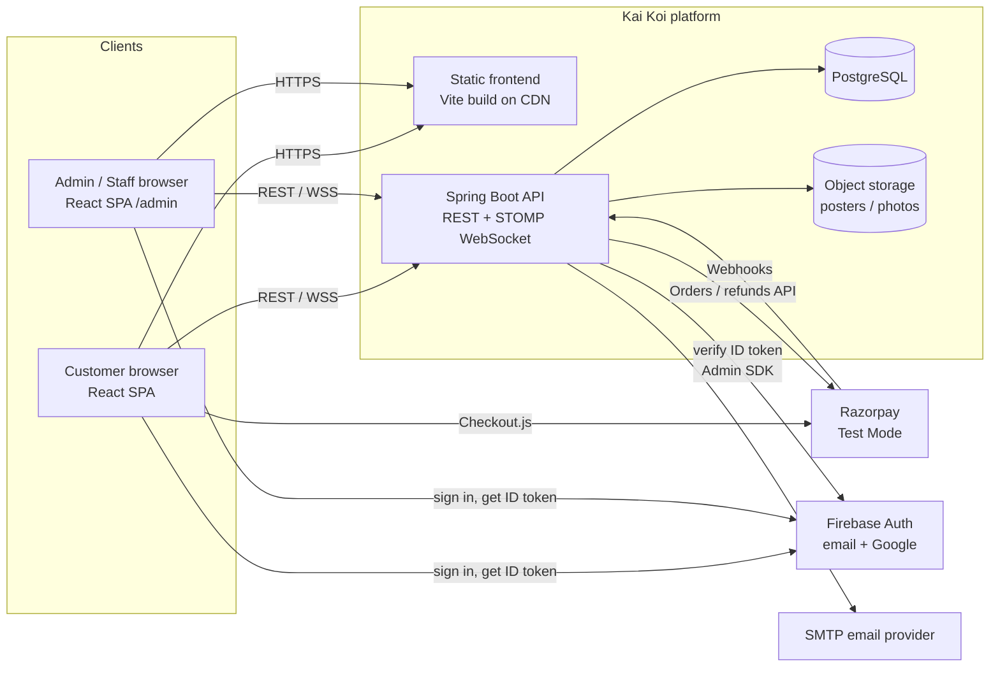
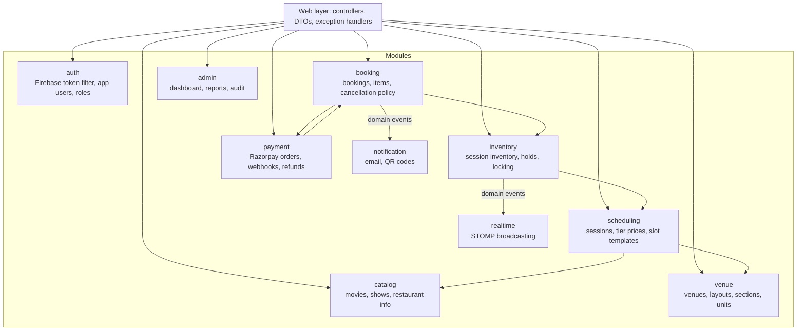
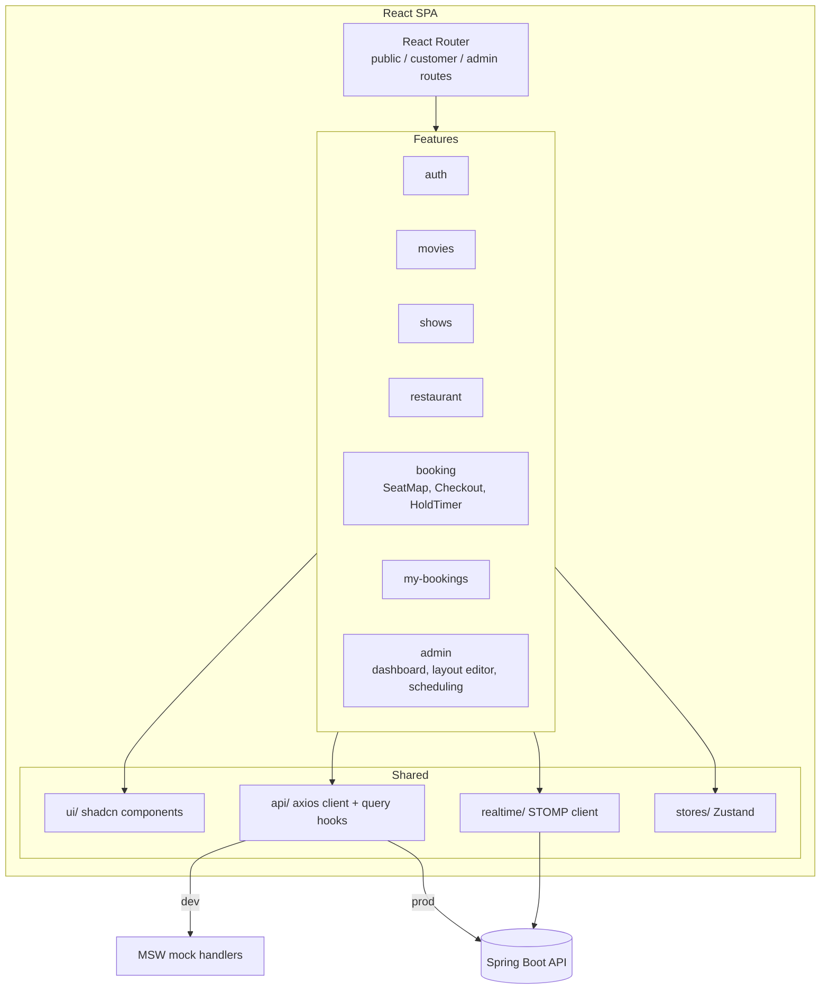
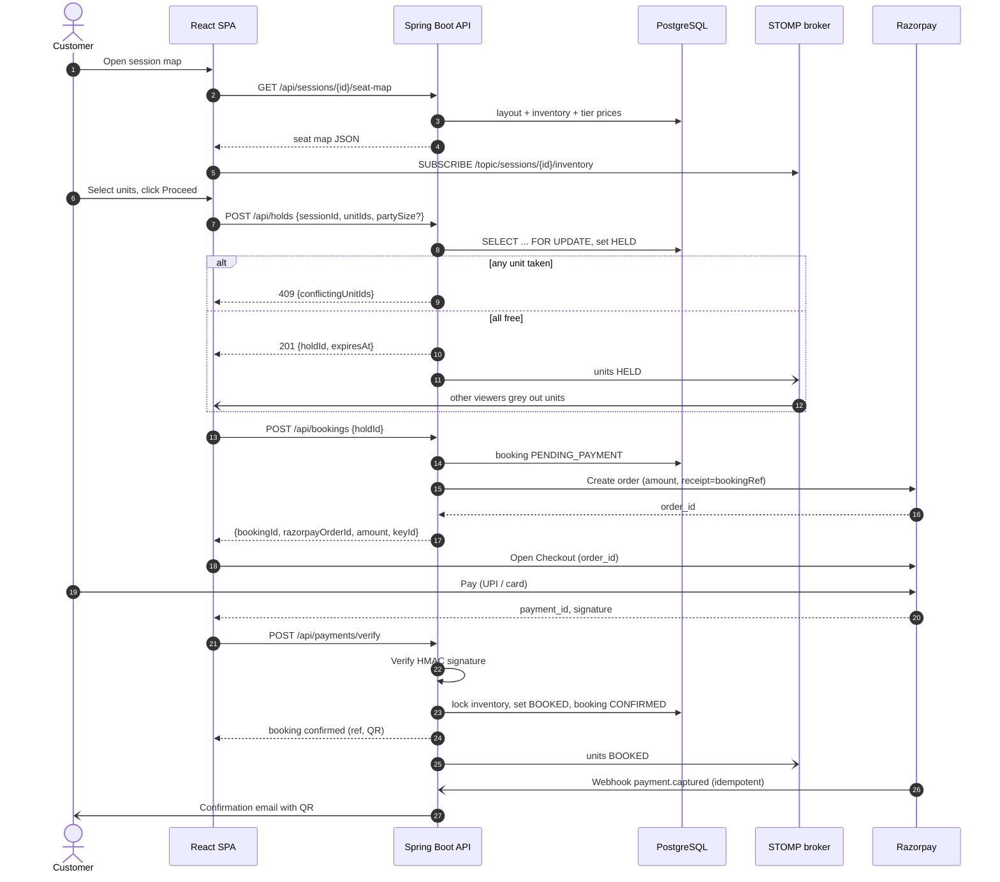
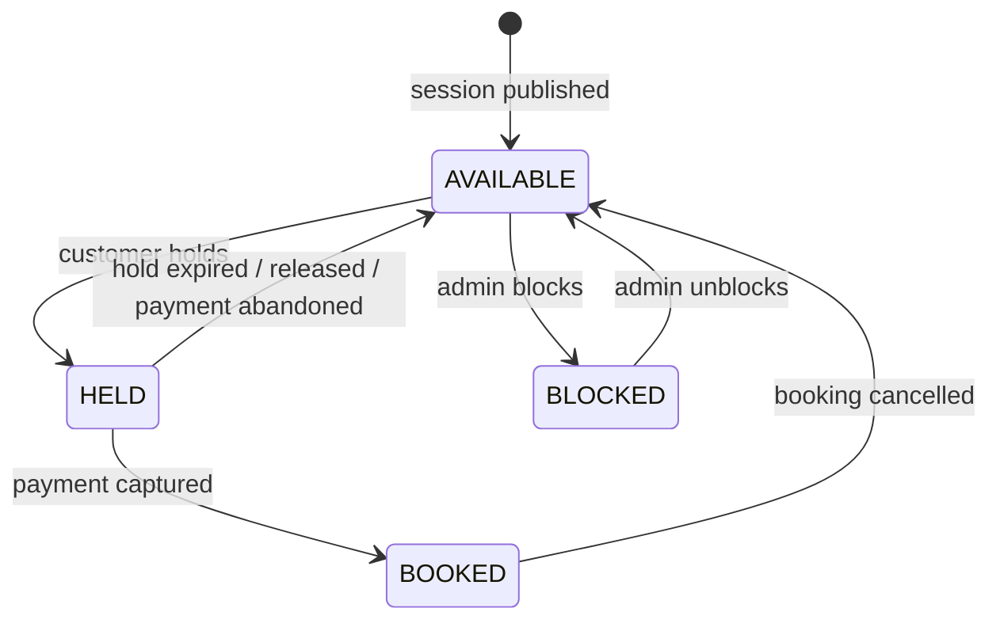
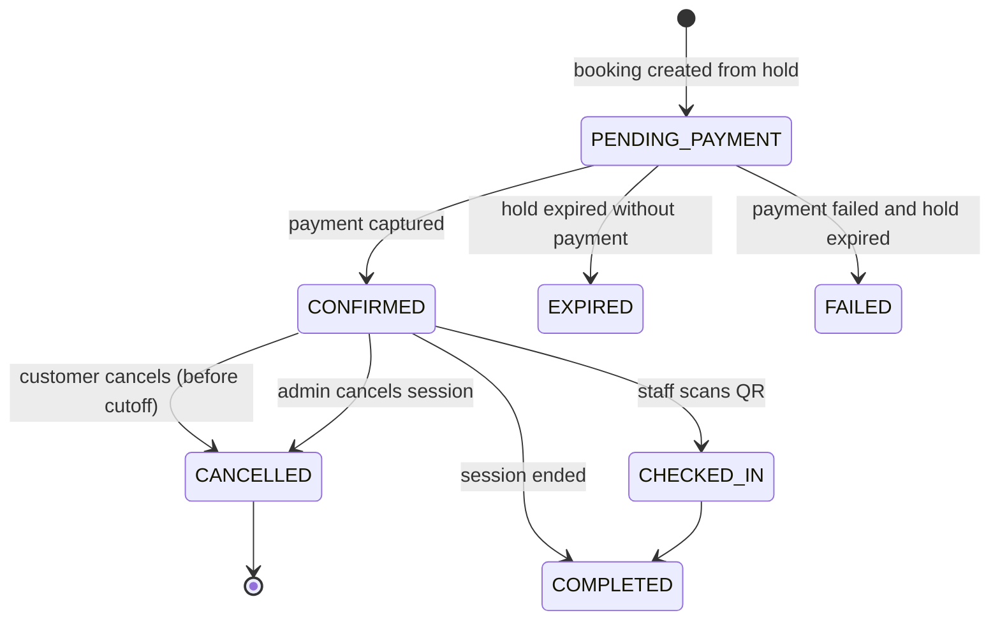
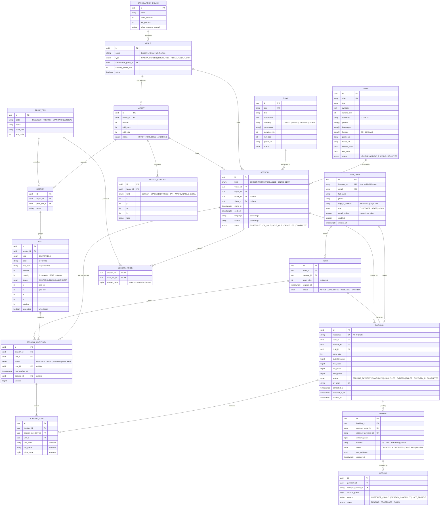

# Kai Koi — Product & Technical Specification

| | |
|---|---|
| **Version** | 0.1 (draft) |
| **Date** | 2026-10-23 |
| **Status** | Draft for review |
| **Scope** | Web application: React frontend + Java Spring Boot backend |

---

## 1. Overview

**Kai Koi** is a single entertainment building that houses three businesses under one brand:

1. **Restaurant**: customers reserve **tables** (1, 2, 4 or 8 seaters) for a dining time slot.
2. **Movie theater**: customers book **seats** for a movie screening.
3. **Show theater**: customers book **seats** for a live show (stand-up, music, theatre, etc.).

Unlike BookMyShow, there is **one business entity and one building**. There are no third-party venues, no city selection and no multi-tenant onboarding. The core booking logic is shared by all three: a customer picks a **session** (a screening, a performance or a dining slot), sees a **visual map** of bookable units (seats or tables) with their live availability, selects units, holds them for a short time, pays through **Razorpay** and receives a confirmation with a QR code.

### 1.1 Goals

- One unified booking engine for seats and tables.
- A visual, interactive seat/table map with live availability for all three verticals.
- No double-booking under concurrent load.
- An admin panel for staff to manage content, layouts, schedules, pricing and bookings.
- A frontend that can be built and demoed before the backend exists, using a mocked API.

### 1.2 Non-goals (v1)

- Multiple businesses, cities or venues outside the Kai Koi building.
- Food ordering, menus with cart, or table-side ordering.
- Native mobile apps (the web app is responsive and mobile-first instead).
- Loyalty points, coupons and gift cards (possible in v2).
- Physical box-office POS.

---

## 2. Decisions made so far

| Topic | Decision |
|---|---|
| Users and auth | Customers must log in to book. Admin panel for staff. |
| Login methods | **Firebase Authentication**: email + password and **Sign in with Google**. The backend verifies Firebase ID tokens; roles live in our own database. |
| Payments | **Razorpay in Test Mode** (INR, fake money, no real charges) for all three verticals. Switching to Live Mode later only means swapping keys. |
| Restaurant payment | Fixed **booking deposit** per table (adjusted against the bill at the venue). |
| Restaurant selection | Choose date → time slot → party size, then pick a **specific table on a floor plan**. |
| Cancellation | Allowed up to a configurable **cutoff** before start, refunded through Razorpay, with an optional cancellation fee. |
| Seat pricing | **Per-section price tiers** (e.g. Recliner / Premium / Standard); prices set per session per tier. |
| Venues | **Configurable by admin**: any number of cinema screens, show halls and restaurant floors, each with its own layout. |
| Live seat updates | **WebSocket (STOMP)** pushes seat changes to everyone viewing a session. |
| Database | **PostgreSQL** with Flyway migrations. |
| Frontend | **Vite + React + TypeScript + Tailwind CSS + shadcn/ui**. |
| Backend | **Java + Spring Boot**. |

---

## 3. Glossary

| Term | Meaning |
|---|---|
| **Venue** | A physical bookable space in the building: a cinema screen, a show hall or a restaurant floor. |
| **Layout** | The arrangement of bookable units in a venue, grouped into sections. |
| **Section** | A group of units in a layout that share a **price tier** (e.g. "Recliner", "Balcony", "Window tables"). |
| **Unit** | A single bookable thing: a **seat** (capacity 1) or a **table** (capacity 1, 2, 4 or 8). |
| **Movie** | Film metadata (title, runtime, certificate, languages…). |
| **Show** | Live-show metadata (title, performers, category, duration…). |
| **Session** | One bookable occurrence at a venue: a movie **screening**, a show **performance**, or a restaurant **dining slot**. |
| **Session inventory** | One row per unit per session holding that unit's live status (available / held / booked / blocked). |
| **Hold** | A temporary lock on selected units while the customer pays (default 10 minutes). |
| **Booking** | A customer's reservation of one or more units in one session. |

---

## 4. Users and roles

| Role | Description | Key permissions |
|---|---|---|
| **Guest** | Not logged in | Browse movies, shows, restaurant info, schedules and seat maps (read-only). |
| **Customer** | Logged-in user | Hold units, pay, view and cancel own bookings, manage profile. |
| **Staff** | Kai Koi front-desk employee | View bookings for a day, look up a booking by reference or QR, mark check-in. |
| **Admin** | Kai Koi manager | Everything Staff can do, plus manage venues, layouts, movies, shows, sessions, pricing, policies, users and refunds. |

> Staff role and check-in are proposed; see Open Questions.

---

## 5. Functional requirements

IDs: `FR-<area>-<n>`. Priority: **M** = must (v1), **S** = should (v1 if time allows), **C** = could (v2).

### 5.1 Authentication and account (AUTH)

Authentication is handled entirely by **Firebase Authentication** (Firebase JS SDK on the frontend). The backend never sees passwords; it only verifies Firebase ID tokens.

| ID | Requirement | P |
|---|---|---|
| FR-AUTH-1 | Sign up with email + password through Firebase; then collect name and phone in an app profile form. | M |
| FR-AUTH-2 | Email verification (Firebase `sendEmailVerification`) required before the first booking. | S |
| FR-AUTH-3 | Log in with email + password (Firebase). | M |
| FR-AUTH-4 | **Sign in with Google** (Firebase Google provider, popup on desktop, redirect on mobile). Firebase links accounts with the same email ("one account per email" setting). | M |
| FR-AUTH-5 | Forgot / reset password through Firebase's password-reset email. | M |
| FR-AUTH-6 | The frontend sends the Firebase **ID token** as `Authorization: Bearer <token>` on every API call; the Firebase SDK refreshes it automatically (tokens last 1 h). | M |
| FR-AUTH-7 | On first authenticated call, the backend creates an `app_user` row keyed by Firebase UID (`POST /me/sync`). Profile page edits name and phone; password change goes through Firebase. | M |
| FR-AUTH-8 | Log out (Firebase `signOut`, clear client caches). | M |
| FR-AUTH-9 | Roles (`CUSTOMER`, `STAFF`, `ADMIN`) are stored in our database, and optionally mirrored to Firebase **custom claims** so the frontend can hide admin routes. The backend always checks the database role. | M |

### 5.2 Browsing (BROWSE)

| ID | Requirement | P |
|---|---|---|
| FR-BROWSE-1 | Home page showing Now Showing movies, Upcoming shows and a restaurant section. | M |
| FR-BROWSE-2 | Movie listing with filters (language, genre, format such as 2D/3D/IMAX, date). | M |
| FR-BROWSE-3 | Movie detail page: poster, trailer link, synopsis, cast, runtime, certificate, and the screenings for the next N days grouped by date. | M |
| FR-BROWSE-4 | Show listing and show detail pages (performers, category, duration, age limit, performances). | M |
| FR-BROWSE-5 | Restaurant page: description, photos, opening hours, booking entry point. | M |
| FR-BROWSE-6 | Global date picker limited to the configured booking window (e.g. 7 days for movies, 30 days for shows/restaurant). | M |
| FR-BROWSE-7 | Search across movies and shows by title. | S |

### 5.3 Seat / table selection (MAP)

The **same map component** renders all three verticals.

| ID | Requirement | P |
|---|---|---|
| FR-MAP-1 | Show the layout of the session's venue with each unit's status: **Available**, **Selected** (by me), **Held/Booked** (unavailable), **Blocked** (admin, e.g. broken seat or reserved). | M |
| FR-MAP-2 | Show a legend with each **price tier** and its price for this session. | M |
| FR-MAP-3 | Cinema/show layouts: rows with labels (A, B, C…), seat numbers, aisles and gaps, a "SCREEN" or "STAGE" marker. | M |
| FR-MAP-4 | Restaurant layout: tables drawn at their floor-plan position with shape (round/square/rect) and capacity; fixed features (entrance, bar, windows) as decoration. | M |
| FR-MAP-5 | Seat bookings: up to **10 seats** per booking (configurable). | M |
| FR-MAP-6 | Restaurant bookings: customer enters **party size** first (1–8); only tables with `capacity ≥ party size` are selectable, and the smallest fitting tables are highlighted as "best fit". One table per booking. | M |
| FR-MAP-7 | Live updates: when another customer holds or books a unit, the map updates within ~1 s without reload (WebSocket). | M |
| FR-MAP-8 | Running summary panel: selected units, tier, price per unit, subtotal, fees, total. | M |
| FR-MAP-9 | Map is usable on mobile (pinch/zoom/pan) and keyboard-accessible (arrow keys move focus, Space/Enter toggles, ARIA labels like "Row D, seat 7, Premium, ₹350, available"). | M |
| FR-MAP-10 | Rule: do not leave a single empty seat stranded between selected seats and an aisle/occupied seat (cinema/show only). | C |

### 5.4 Holding, checkout and payment (BOOK)

| ID | Requirement | P |
|---|---|---|
| FR-BOOK-1 | Clicking **Proceed** creates a **hold** on the selected units atomically: all are held or none are. A conflict returns which units were taken. | M |
| FR-BOOK-2 | A hold lasts **10 minutes** (configurable). A countdown timer is shown on the checkout page. | M |
| FR-BOOK-3 | Expired holds are released automatically and broadcast to viewers of the map. | M |
| FR-BOOK-4 | Checkout page: session details, units, price breakup (base, convenience fee, taxes), cancellation policy, and a "Pay" button. | M |
| FR-BOOK-5 | Payment through **Razorpay Checkout in Test Mode** (`rzp_test_…` keys; Razorpay's published test cards / test UPI IDs; no real money moves). The backend creates the Razorpay order; the frontend opens Checkout; the backend verifies the signature. The UI shows a "Test mode: no real payment" badge. | M |
| FR-BOOK-6 | **Razorpay webhook** (`payment.captured`, `payment.failed`, `refund.processed`) is the source of truth; it is idempotent and handles the case where the browser closes before verification. | M |
| FR-BOOK-7 | On success: booking becomes **CONFIRMED**, units become **BOOKED**, a booking reference (e.g. `KK-7F3K9Q`) and a QR code are generated, and a confirmation email is sent. | M |
| FR-BOOK-8 | Payment failure or cancel: the hold stays alive until it expires so the customer can retry. | M |
| FR-BOOK-9 | If a payment is captured **after** the hold expired and the units were taken, the system automatically refunds it in full and notifies the customer. | M |
| FR-BOOK-10 | The customer can release a hold manually ("Change seats"). | S |
| FR-BOOK-11 | Restaurant deposit amount is set per table tier (e.g. ₹200 standard, ₹500 for an 8-seater). The confirmation says it will be adjusted against the bill. | M |

### 5.5 My bookings and cancellation (MYB)

| ID | Requirement | P |
|---|---|---|
| FR-MYB-1 | "My Bookings" with Upcoming / Past / Cancelled tabs. | M |
| FR-MYB-2 | Booking detail: QR code, reference, session info, units, payment summary, status. | M |
| FR-MYB-3 | Cancel a booking if `now < session.start − cutoff`. The cutoff and fee are defined by a **cancellation policy** per venue type (e.g. movies 2 h / 10 %, shows 24 h / 20 %, restaurant 2 h / 0 %). | M |
| FR-MYB-4 | On cancel, units are released immediately, and a Razorpay refund for `amount − fee` is started. Status shows refund progress. | M |
| FR-MYB-5 | Partial cancellation (some seats only). | C |
| FR-MYB-6 | Download the ticket as PDF or add it to a wallet. | C |

### 5.6 Admin panel (ADM)

| ID | Requirement | P |
|---|---|---|
| FR-ADM-1 | Dashboard: today's sessions, occupancy %, bookings and revenue (today / 7 days). | M |
| FR-ADM-2 | **Venues**: create/edit/archive cinema screens, show halls and restaurant floors. | M |
| FR-ADM-3 | **Layout editor (seats)**: define rows × columns on a grid, mark gaps/aisles, label rows, assign cells to sections (tiers). | M |
| FR-ADM-4 | **Layout editor (restaurant)**: place tables on a grid by drag-and-drop, set shape and capacity (1/2/4/8), assign a section/tier, add decorative features. | M |
| FR-ADM-5 | A layout cannot be edited once it has future sessions with bookings; a new layout version is created instead. | M |
| FR-ADM-6 | **Movies**: CRUD with poster upload, genres, languages, formats, certificate, runtime, release/end dates. | M |
| FR-ADM-7 | **Shows**: CRUD with performers, category, duration, age limit, poster. | M |
| FR-ADM-8 | **Sessions**: schedule screenings and performances (venue, start time, language/format, tier prices). The system prevents overlaps on the same venue, including a configurable cleaning buffer. | M |
| FR-ADM-9 | **Restaurant slots**: generate dining slots for a date range from a template (e.g. 12:00, 13:30, 19:00, 20:30, 22:00; 90 min each), with deposit per tier. | M |
| FR-ADM-10 | Bulk scheduling (repeat a session daily or weekly over a date range). | S |
| FR-ADM-11 | Block or unblock specific units for a session (VIP, broken seat). | M |
| FR-ADM-12 | Cancel an entire session: all bookings are refunded in full and customers are emailed. | M |
| FR-ADM-13 | Bookings search (by reference, email, phone, date, session), with booking detail and manual refund. | M |
| FR-ADM-14 | Cancellation policy and global settings (hold duration, max seats, booking windows, convenience fee). | M |
| FR-ADM-15 | User management: list users, change roles, disable accounts. | S |
| FR-ADM-16 | Staff check-in screen: scan a QR code or enter a reference, then mark it checked in. | S |
| FR-ADM-17 | Reports export (CSV) for bookings and revenue. | C |

### 5.7 Notifications (NOTIF)

| ID | Requirement | P |
|---|---|---|
| FR-NOTIF-1 | Emails (verification and password reset are sent by Firebase): booking confirmed (with QR), booking cancelled / refund started, session cancelled by venue, late-payment auto-refund. | M |
| FR-NOTIF-2 | Reminder email N hours before the session. | C |
| FR-NOTIF-3 | SMS / WhatsApp notifications. | C |

---

## 6. Non-functional requirements

| ID | Area | Requirement |
|---|---|---|
| NFR-1 | Correctness | **Zero double-bookings.** Enforced by database constraints and row-level locks, not only by application checks. |
| NFR-2 | Performance | Seat map API p95 < 300 ms; WebSocket updates delivered < 1 s; first contentful paint < 2 s on 4G. |
| NFR-3 | Scale (v1) | Up to ~500 concurrent users and ~1,000 units per session. A single backend instance is enough; the design allows horizontal scaling later (see §8.5). |
| NFR-4 | Security | OWASP Top 10; passwords handled only by Firebase; every API call verifies the Firebase ID token (signature, audience = Firebase project, expiry, revocation for admin actions); HTTPS only; CORS limited to the frontend origin; rate limiting on auth and hold endpoints; Razorpay signature verification; no card data stored (PCI scope stays with Razorpay). |
| NFR-5 | Accessibility | WCAG 2.1 AA, including a keyboard- and screen-reader-usable seat map. |
| NFR-6 | Responsiveness | Mobile-first; supported from 360 px wide to desktop. |
| NFR-7 | Browsers | Latest two versions of Chrome, Safari, Firefox and Edge; iOS Safari 16+. |
| NFR-8 | Time | All times stored in UTC; displayed in **Asia/Kolkata (IST)**. |
| NFR-9 | Currency | INR, stored as integer **paise** (no floating point money). |
| NFR-10 | Observability | Structured JSON logs with request IDs; Spring Boot Actuator health/metrics; audit log for admin actions. |
| NFR-11 | Testing | Backend: unit + integration tests with Testcontainers (including concurrent hold tests). Frontend: unit/component tests with Vitest + Testing Library; E2E for the booking flow with Playwright. |

---

## 7. Tech stack

### 7.1 Frontend

| Concern | Choice |
|---|---|
| Build tool | Vite |
| Framework | React 19 + TypeScript (strict mode) |
| Styling | Tailwind CSS v4 + shadcn/ui (Radix primitives) |
| Routing | React Router (data router) |
| Server state | TanStack Query |
| Client state | Zustand (seat selection, hold timer, auth session) |
| Forms and validation | React Hook Form + Zod |
| HTTP | Axios instance with an interceptor that attaches `await auth.currentUser.getIdToken()` and retries once with a forced refresh on 401 |
| Authentication | **Firebase JS SDK** (`firebase/auth`): email/password + Google provider; Firebase Auth Emulator for local dev |
| Real-time | `@stomp/stompjs` over native WebSocket |
| Seat map rendering | SVG (React components) with `react-zoom-pan-pinch` for mobile zoom |
| Admin layout editor | SVG + `@dnd-kit/core` for drag-and-drop |
| Payments | Razorpay Checkout (`checkout.js`) with Test Mode key |
| Dates | `date-fns` + `date-fns-tz` |
| QR display | `qrcode.react` |
| API mocking | **MSW (Mock Service Worker)**, so the frontend can be built before the backend |
| API types | Generated from the backend's OpenAPI spec with `openapi-typescript` (hand-written until the backend exists) |
| Testing | Vitest, React Testing Library, Playwright |
| Code quality | ESLint, Prettier, Husky + lint-staged |

### 7.2 Backend

| Concern | Choice |
|---|---|
| Language / runtime | Java 21 LTS |
| Framework | Spring Boot 3.x (latest stable at project start) |
| Web | Spring Web MVC (REST, JSON) |
| Security | Spring Security (stateless) with a filter that verifies Firebase ID tokens using the **Firebase Admin SDK** (`FirebaseAuth.verifyIdToken`), then loads the role from `app_user` |
| Persistence | Spring Data JPA (Hibernate), PostgreSQL 16 |
| Migrations | Flyway |
| Real-time | Spring WebSocket + STOMP (simple in-memory broker for v1) |
| Payments | Razorpay Java SDK + webhooks, **Test Mode** keys (`rzp_test_…`); webhooks reach local dev through a tunnel (e.g. ngrok / cloudflared) |
| Scheduling | Spring `@Scheduled` + ShedLock (hold expiry, refund reconciliation) |
| Email | Spring Mail + Thymeleaf templates (SMTP provider TBD) |
| File storage | Local disk in dev; S3-compatible object storage in prod (posters, photos) |
| Mapping / boilerplate | MapStruct, Lombok |
| Validation | Jakarta Bean Validation |
| API docs | springdoc-openapi (Swagger UI) |
| Rate limiting | Bucket4j |
| Testing | JUnit 5, Mockito, Testcontainers (PostgreSQL), REST Assured |
| Build | Maven or Gradle (TBD) |

### 7.3 Infrastructure (proposed)

| Concern | Choice |
|---|---|
| Local dev | Docker Compose: PostgreSQL, Mailpit (email catcher), backend |
| Hosting | TBD (e.g. a VPS or AWS: frontend as static files on a CDN, backend as a container) |
| CI | GitHub Actions: lint, test, build |
| Secrets | Environment variables; never committed |

---

## 8. Architecture

### 8.1 System context



### 8.2 Backend modules (modular monolith)

One deployable Spring Boot application, split into packages with clear boundaries:



Modules talk to each other through service interfaces and Spring application events (for example `UnitsHeldEvent`, `BookingConfirmedEvent`). Events are published **after commit** so WebSocket broadcasts and emails never describe a rolled-back transaction.

### 8.3 Frontend architecture



**Proposed folder structure**

```
frontend/
├── src/
│   ├── app/                # providers, router, layouts, error boundaries
│   ├── features/
│   │   ├── auth/
│   │   ├── movies/
│   │   ├── shows/
│   │   ├── restaurant/
│   │   ├── booking/        # SeatMap, UnitShape, Legend, Summary, Checkout, HoldTimer
│   │   ├── my-bookings/
│   │   └── admin/
│   ├── components/ui/      # shadcn/ui generated components
│   ├── lib/                # api client, query client, stomp client, utils, money/date helpers
│   ├── stores/             # zustand stores
│   ├── types/              # API types (later generated from OpenAPI)
│   └── mocks/              # MSW handlers + fixtures (layouts, sessions)
├── public/
└── tests/e2e/              # Playwright
```

**Route map**

| Path | Page | Access |
|---|---|---|
| `/` | Home | Public |
| `/movies`, `/movies/:slug` | Movie list / detail with screenings | Public |
| `/shows`, `/shows/:slug` | Show list / detail with performances | Public |
| `/restaurant` | Restaurant info + date / slot / party-size picker | Public |
| `/sessions/:id/select` | **Seat / table map** | Public view; login required to proceed |
| `/checkout/:holdId` | Checkout + hold timer + Razorpay | Customer |
| `/bookings`, `/bookings/:ref` | My bookings / booking detail with QR | Customer |
| `/login`, `/signup`, `/forgot-password` | Auth (Firebase UI built with our components) | Public |
| `/account` | Profile | Customer |
| `/admin/*` | Dashboard, venues, layouts, movies, shows, sessions, bookings, settings, check-in | Admin / Staff |

### 8.4 One booking engine for three verticals

All three verticals share the same model and flow. Only the **content** and **map rendering** differ:

| | Movie | Show | Restaurant |
|---|---|---|---|
| Venue type | `CINEMA_SCREEN` | `SHOW_HALL` | `RESTAURANT_FLOOR` |
| Unit type | `SEAT` (capacity 1) | `SEAT` (capacity 1) | `TABLE` (capacity 1/2/4/8) |
| Session = | Screening of a Movie | Performance of a Show | Dining slot (no content) |
| Units per booking | 1–10 seats | 1–10 seats | 1 table, with party size |
| Price per unit | Ticket price by tier | Ticket price by tier | Deposit by tier |
| Map renders | Grid rows + screen | Grid rows + stage | Floor plan + tables |

Restaurant slots are **fixed and non-overlapping** per venue (for example 90-minute slots). That keeps restaurant inventory identical to cinema inventory: one status per table per slot, with no overlapping-time arithmetic.

### 8.5 Concurrency and double-booking prevention

1. When a session is published, the backend creates **one `session_inventory` row per unit** (`UNIQUE(session_id, unit_id)`).
2. **Hold** runs in a single transaction:
   ```sql
   SELECT * FROM session_inventory
   WHERE session_id = :sid AND unit_id IN (:units)
   ORDER BY unit_id            -- fixed lock order prevents deadlocks
   FOR UPDATE;
   ```
   Every row must be `AVAILABLE`, or `HELD` with `hold_expires_at < now()`. Otherwise the transaction rolls back and the API returns **409** with the conflicting unit IDs. If they are all free, the rows are set to `HELD`, `hold_id`, `hold_expires_at`.
3. **Confirm** (payment captured): same lock, then verify the rows still belong to this hold, set them to `BOOKED` with `booking_id`. If they no longer belong to the hold (it expired and someone else took them), the payment is refunded (FR-BOOK-9).
4. **Expiry job** (every 30 s, with ShedLock) releases expired holds and broadcasts the change. Expired holds are also treated as free at read time, so correctness never depends on the job's timing.
5. An optimistic `version` column on `session_inventory` adds a second safety net.
6. Scaling out later: replace the in-memory STOMP broker with an external broker relay (RabbitMQ) or Redis pub/sub. The locking itself already works across instances because it lives in PostgreSQL.

### 8.6 Booking flow (sequence)



### 8.7 State machines

**Unit status within a session (`session_inventory.status`)**



**Booking status**



Refund progress is tracked separately on the `refund` record (`PENDING → PROCESSED | FAILED`), so a cancelled booking can show "refund in progress" or "refunded".

---

## 9. Data model

### 9.1 Entity-relationship diagram



Supporting tables not shown: `dining_slot_template` (venue, weekday, start time, duration), `app_setting` (key/value for hold minutes, max seats, booking windows, convenience fee), `audit_log`, `webhook_event` (Razorpay event ID for idempotency), `shedlock`.

### 9.2 Key constraints and indexes

| Table | Constraint / index | Purpose |
|---|---|---|
| `session_inventory` | `UNIQUE (session_id, unit_id)` | One status per unit per session. |
| `session_inventory` | Index `(session_id, status)` | Fast seat-map reads. |
| `session_inventory` | Index `(status, hold_expires_at)` | Fast expiry sweeps. |
| `session` | `CHECK` exactly one of `movie_id` / `show_id` / neither matches `kind` | Content integrity. |
| `session` | `EXCLUDE USING gist (venue_id WITH =, tstzrange(starts_at, ends_at) WITH &&) WHERE status <> 'CANCELLED'` | No overlapping sessions in one venue. |
| `unit` | `UNIQUE (section_id … layout, label)` | Unique seat/table labels per layout. |
| `unit` | `CHECK (type = 'SEAT' AND capacity = 1) OR (type = 'TABLE' AND capacity IN (1,2,4,8))` | Valid capacities. |
| `booking` | `UNIQUE (reference)`, `UNIQUE (qr_token)` | Lookup and check-in. |
| `payment` | `UNIQUE (razorpay_payment_id)` | Webhook idempotency. |
| `webhook_event` | `UNIQUE (event_id)` | Process each Razorpay event exactly once. |

---

## 10. API specification (v1 outline)

Base path `/api/v1`. JSON. Errors follow RFC 9457 (`application/problem+json`) with a machine-readable `code`, e.g. `UNITS_UNAVAILABLE`, `HOLD_EXPIRED`, `CANCELLATION_WINDOW_CLOSED`.

### 10.1 Public and customer

Sign-up, login, Google sign-in, password reset and email verification happen **directly between the browser and Firebase**; there are no `/auth/*` endpoints on our backend. "Customer" below means a request with a valid Firebase ID token in `Authorization: Bearer`.

| Method | Path | Description | Auth |
|---|---|---|---|
| POST | `/me/sync` | Create or update the `app_user` row from the token (UID, email, provider, verified flag); returns profile + role | Customer |
| GET / PATCH | `/me` | Profile (name, phone) | Customer |
| GET | `/movies?status=&lang=&genre=&date=` | Movie list | — |
| GET | `/movies/{slug}` | Movie detail | — |
| GET | `/movies/{slug}/sessions?from=&to=` | Screenings | — |
| GET | `/shows`, `/shows/{slug}`, `/shows/{slug}/sessions` | Shows | — |
| GET | `/restaurant` | Restaurant info | — |
| GET | `/restaurant/slots?date=&partySize=` | Dining slots for a date, with count of fitting free tables | — |
| GET | `/sessions/{id}` | Session detail | — |
| GET | `/sessions/{id}/seat-map` | Layout + features + units + live status + tier prices | — |
| POST | `/holds` | `{sessionId, unitIds[], partySize?}` → `{holdId, expiresAt}` or 409 | Customer |
| DELETE | `/holds/{id}` | Release a hold | Customer |
| POST | `/bookings` | `{holdId}` → booking + Razorpay order details | Customer |
| POST | `/payments/verify` | `{bookingId, razorpayOrderId, razorpayPaymentId, signature}` | Customer |
| POST | `/payments/webhook` | Razorpay webhook (signature in header) | Razorpay |
| GET | `/bookings?scope=upcoming\|past\|cancelled` | My bookings | Customer |
| GET | `/bookings/{reference}` | Booking detail with QR token | Customer |
| GET | `/bookings/{reference}/cancellation-quote` | Refund amount and fee if cancelled now | Customer |
| POST | `/bookings/{reference}/cancel` | Cancel and start the refund | Customer |

### 10.2 Admin and staff (`/api/v1/admin/...`)

CRUD for `venues`, `venues/{id}/layouts` (+ `publish`), `price-tiers`, `movies`, `shows`, `sessions` (+ `bulk`, `cancel`), `sessions/{id}/inventory/block`, `restaurant/slot-templates` (+ `generate`), `bookings` (search, detail, refund), `users`, `settings`, `cancellation-policies`, `dashboard`, `checkin` (Staff+).

### 10.3 WebSocket

- Endpoint: `/ws` (STOMP over WebSocket; Firebase ID token optional in the CONNECT headers, because the seat map is public).
- Topic: `/topic/sessions/{sessionId}/inventory`
- Message:
  ```json
  { "sessionId": "…", "changes": [ { "unitId": "…", "status": "HELD" } ], "at": "2026-10-23T12:00:00Z" }
  ```
- The client applies changes on top of the REST snapshot. On reconnect it refetches the snapshot.
- The customer's own held units come back as `HELD` and are shown as "selected" by comparing with the local hold.

### 10.4 Seat-map response (shape used by the frontend)

```json
{
  "session": { "id": "…", "kind": "SCREENING", "startsAt": "…", "title": "Dune: Part Three", "venueName": "Screen 2" },
  "layout": { "gridRows": 14, "gridCols": 24 },
  "features": [ { "kind": "SCREEN", "x": 2, "y": 0, "w": 20, "h": 1, "label": "SCREEN" } ],
  "tiers": [ { "id": "…", "code": "RECLINER", "name": "Recliner", "color": "#C2185B", "pricePaise": 45000 } ],
  "units": [
    { "id": "…", "type": "SEAT", "label": "A1", "row": "A", "number": 1, "capacity": 1,
      "shape": "SEAT", "x": 2, "y": 2, "w": 1, "h": 1, "tierId": "…", "accessible": false,
      "status": "AVAILABLE" }
  ],
  "rules": { "maxUnits": 10, "holdMinutes": 10, "partySizeRequired": false }
}
```

For a restaurant session, `units` have `"type": "TABLE"`, `capacity` 1/2/4/8, a table `shape`, and `rules.partySizeRequired: true`.

---

## 11. UI / UX notes

- **Seat map component**: a single `<SeatMap>` takes the seat-map JSON and renders an SVG grid. `UnitShape` picks the drawing by `unit.type` and `shape` (seat icon, round table with chairs around it, square or rectangular table). Colour comes from the tier; status overrides it (grey = unavailable, brand colour = selected, hatched = blocked).
- **Restaurant flow**: date → party size → slot cards (each showing "6 tables available") → floor plan with non-fitting tables dimmed and best-fit tables outlined.
- **Hold timer**: a sticky countdown on checkout. At 0, show a modal ("Your seats were released") and go back to the map.
- **Optimistic UI**: selection is local. Only "Proceed" calls the API. On 409, the conflicting units shake, get removed from the selection, and a toast explains why.
- **Empty and error states**: sold out, session cancelled, booking window not open yet, network lost (WebSocket "reconnecting…" badge).
- **Theme**: Kai Koi brand colours and logo are not yet defined (see Open Questions). Dark mode is supported through Tailwind tokens.

---

## 12. Frontend delivery plan (frontend first)

| Phase | Deliverable |
|---|---|
| F0 | Project scaffold: Vite + React + TS, Tailwind, shadcn/ui, Router, Query, Zustand, ESLint/Prettier, MSW, Vitest. |
| F1 | Design tokens, app shell (header, footer, nav), home page with mock data. |
| F2 | Movies and shows: list, detail and session pickers. Restaurant page with date / party size / slot picker. |
| F3 | **SeatMap component** (seats + tables), legend, summary, keyboard/ARIA, mobile zoom; MSW seat-map fixtures for all three venue types; simulated live updates. |
| F4 | Firebase project setup, auth pages (email + Google), `AuthProvider` with `onAuthStateChanged`, protected and role-gated routes. Works against the Firebase Auth Emulator or a real dev project. |
| F5 | Hold → checkout → Razorpay Test Mode Checkout → confirmation with QR. Until the backend exists, MSW fakes the order and verify calls. |
| F6 | My bookings, booking detail, cancellation with refund quote. |
| F7 | Admin: dashboard, CRUD screens, sessions and slot generation. |
| F8 | Admin layout editors (seat grid and restaurant floor plan). |
| F9 | Swap MSW for the real API, generate types from OpenAPI, E2E tests. |

The **API contract in §10** is the agreement between frontend and backend. MSW handlers will implement it, so the backend can be built to the same contract in parallel.

---

## 13. Assumptions (please confirm)

1. Currency is INR and the timezone is IST; the business is in India (implied by Razorpay).
2. Hold duration is 10 minutes; up to 10 seats per booking.
3. Restaurant: one table per booking, party size 1–8. Groups larger than 8 contact the restaurant directly.
4. Restaurant dining slots are fixed and non-overlapping (e.g. 90 minutes).
5. Booking windows: movies 7 days ahead, shows and restaurant 30 days ahead.
6. A convenience fee and GST may apply to tickets; amounts are configurable and default to 0.
7. Example cancellation policies: movies 2 h before / 10 % fee; shows 24 h / 20 %; restaurant 2 h / no fee (full deposit refund).
8. The seat map is publicly viewable; login is required only when proceeding to hold.
9. English only.

## 14. Open questions

| # | Question |
|---|---|
| Q1 | Do you have **branding** (logo, colours, fonts) or Figma designs, or should the frontend define a design system? |
| Q2 | Should there be a separate **Staff** role with QR **check-in** at the door, or only Admin? |
| Q3 | Restaurant no-shows: is the deposit forfeited if the guest does not arrive? Should there be a grace period? |
| Q4 | Should the restaurant page show a **menu** (read-only), or nothing beyond info and booking? |
| Q5 | **Fees and tax**: is there a convenience fee? Is GST added on top of or included in ticket prices? Do we need GST invoices? |
| Q6 | Which **email provider** for booking emails (e.g. Resend, SendGrid, plain SMTP)? Firebase only sends auth emails. |
| Q12 | Do you already have a **Firebase project** (and a Razorpay test account), or should setup steps be part of F0/F4? |
| Q7 | Where will it be **hosted**, and do you have a domain? |
| Q8 | Backend build tool: **Maven or Gradle**? Who is building the backend, and when? |
| Q9 | Do you want a "**combo**" later (e.g. dinner + movie in one booking)? It does not change v1, but it affects how far the booking model should generalise. |
| Q10 | Is a **phone number** mandatory at signup (useful for the restaurant to call guests)? |
| Q11 | Should a movie session list multiple **languages/formats** of the same film as separate sessions (current design), or as one session with variants? |
